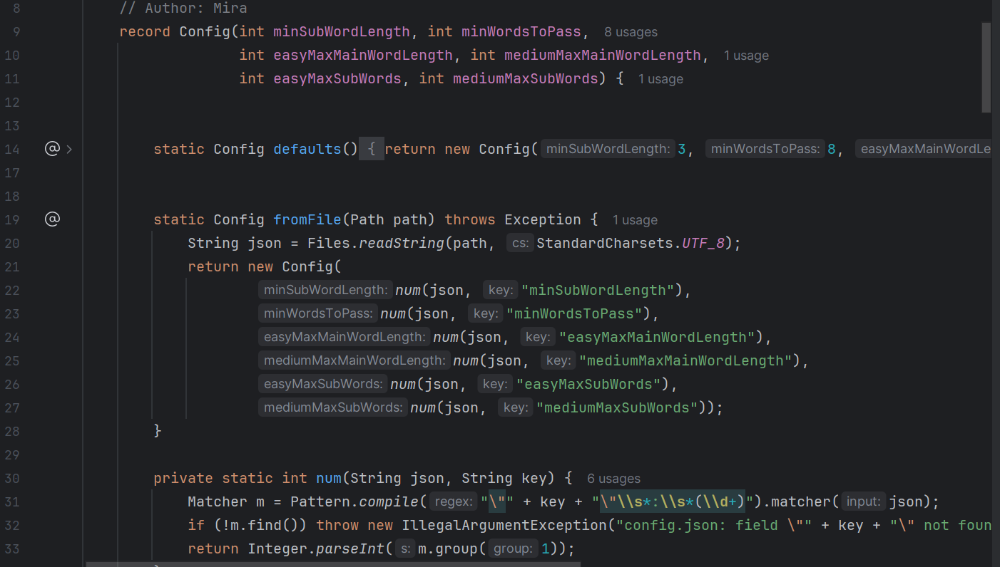
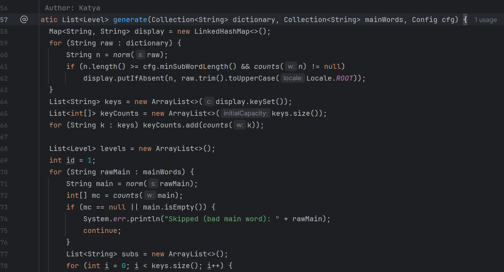
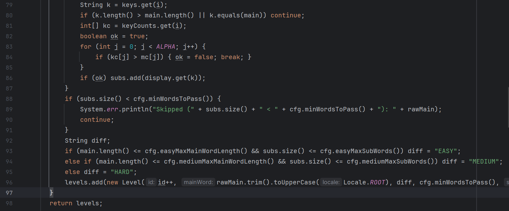
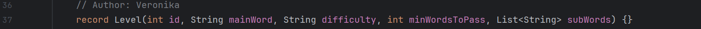
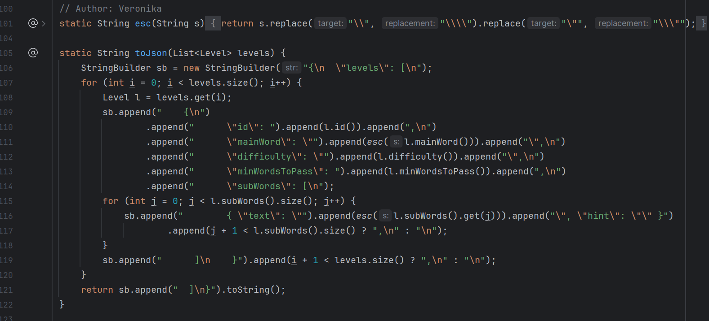

# Words from Word Generator

## Project Description
This Java application implements the "Words from Word" algorithm. Based on a given dictionary and a list of main words, it generates a structured JSON of levels. Each level contains the main word, a set of valid subwords, the calculated difficulty, and the minimum number of subwords required to pass the level.

## Features
*   Reads input data from files.
*   Filters subwords based on `minSubWordLength` from the config.
*   Handles letter multiplicity (e.g., if a word has one 'Я', you cannot make a subword with two).
*   Handles the letter 'Ё' by folding it into 'Е'.
*   Automatically calculates the level difficulty (`EASY`, `MEDIUM`, `HARD`).
*   Validates input (skips levels if there are not enough valid subwords).

## Division of Work
The code is divided into logical blocks using author comments.

**Mira**
*   Implemented the `Config` parsing logic.
*   Developed File I/O operations (`readWords` method) and the `main` execution flow.

**Katya**
*   Developed the core generation algorithm (`generate` method).
*   Implemented word normalization and letter count filtering.

**Veronika**
*   Created data models (`Level` record).
*   Implemented manual JSON serialization (`toJson` and `esc` methods).

## How to Run
1. Open the project in IntelliJ IDEA.
2. Run the `WordsFromWord` class.
3. Provide arguments: `dict.txt mains.txt config.json`

   
   ## Code Breakdown

### 1. Configuration and File I/O (Mira)
This fragment shows how the program reads the configuration JSON and processes input files.

### 2. Core Algorithm (Katya)
This is the heart of the application. It normalizes words and calculates character counts to filter valid subwords.

### 3. JSON Serialization (Veronika)
This part is responsible for generating the final JSON output and creating data models.

 ## Configuration (`config.json`)

The generation process is controlled by a separate configuration file. **Important:** As per the assignment requirements, this configuration does not appear in the final JSON output; it only affects the generation logic.

Our `config.json` contains the following rules:
*   `minSubWordLength: 3` — Only words with 3 or more letters are considered valid subwords.
*   `minWordsToPass: 8` — The player must find at least 8 subwords to pass the level. If the dictionary doesn't have 8 valid subwords, the level is skipped.
*   `difficultyThresholds` — Sets the rules for `EASY`, `MEDIUM`, and `HARD` difficulties based on the main word length (7 and 10) and the number of subwords (15 and 30).

This modular approach allows balancing the game difficulty by simply editing a JSON file, without recompiling the Java code.
